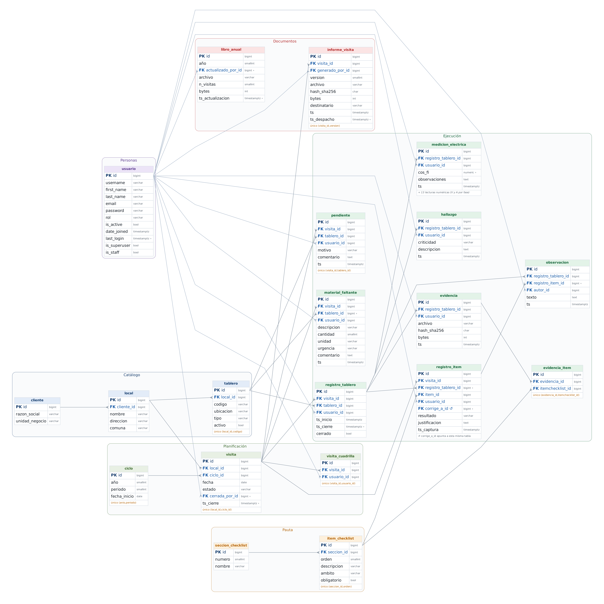

# Modelo de datos

Proyecto IMELSE · ICN-292 Sistemas de Información para la Gestión · UTFSM 2026-2

Motor declarado: **PostgreSQL 16**. El esquema ejecutable está en
[`db/schema.sql`](../db/schema.sql) y los datos de demostración en
[`db/seed.sql`](../db/seed.sql).

---

## 1. Cómo se construyó este documento

El diagrama no se dibujó a mano. Se genera **leyendo el catálogo de la base de
datos real**: nombres de tabla, columnas, tipos, claves primarias, foráneas y
restricciones de unicidad salen de `information_schema`. Por construcción, el
diagrama de este informe y el esquema que corre son el mismo objeto.

Esa decisión responde directamente a uno de los criterios de aceptación del
enunciado, el que pregunta si el BPMN *to-be* y el ER/SQL cuentan la misma
historia de negocio. Acá no hay dos versiones que puedan divergir: hay una.

También disponible en [SVG](diagramas/er-modelo-datos.svg) y
[PDF](diagramas/er-modelo-datos.pdf) para impresión.

**20 entidades de negocio, 36 relaciones.** En el diagrama, `PK` marca la clave
primaria, `FK` las foráneas, el símbolo `∘` indica que la columna admite nulos,
y en naranja aparecen las restricciones de unicidad compuesta, que son donde
viven las reglas del negocio.

---

## 2. Las seis áreas del modelo

El modelo se organiza en seis áreas, y entenderlas en este orden es la forma
más rápida de entender el sistema completo.

**Personas.** Una sola entidad, `usuario`, con el atributo `rol` que decide qué
puede hacer cada quien. Nueve tablas la referencian, porque toda acción sobre
un registro queda atribuida a una persona identificada. Esa atribución no es un
adorno: es la condición para que la evidencia sirva frente a un reclamo.

**Catálogo.** `cliente` → `local` → `tablero`. Es la columna vertebral del
problema. **La existencia de la tabla `tablero` es la solución**: el checklist
en papel no sabe cuántos tableros tiene un local, y por eso no puede detectar
que falta uno. Acá el denominador de la cobertura es una consulta.

**Pauta.** `seccion_checklist` → `item_checklist`. Los 25 puntos de control
viven como datos, no escritos dentro del código. Si IMELSE agrega un punto a su
ficha, se agrega una fila. El atributo `ambito` es la única adición del
rediseño: separa los 10 ítems que se responden una vez por visita de los 15 que
van tablero por tablero, y esa separación es exactamente la trazabilidad que el
papel no permitía.

**Planificación.** `ciclo` y `visita`, más la relación N:M `visita_cuadrilla`.
El contrato es bimensual, de modo que el ciclo es el período de cumplimiento y
la visita su ejecución concreta en un local.

**Ejecución.** Nueve entidades que registran lo que pasó en terreno.
`registro_tablero` agrupa el trabajo sobre un tablero, `registro_item` guarda
cada respuesta, `evidencia` las fotografías, `pendiente` la declaración
explícita de lo que no se hizo y `material_faltante` lo que no había para
hacerlo. Todas son append-only.

**Documentos.** `informe_visita` y `libro_anual`, que son las salidas que el
sistema produce. La diferencia entre ambas se explica en la sección 6.

---

## 3. Diccionario de datos

Se omiten las columnas de infraestructura del framework (`last_login`,
`is_staff`, `is_superuser` en `usuario`), que no forman parte del modelo de
negocio.

### usuario

| Atributo | Tipo | Clave | Regla |
|---|---|---|---|
| id | bigint | PK | Subrogada |
| username | varchar(150) | | Único |
| first_name, last_name | varchar(150) | | |
| email | varchar(254) | | |
| password | varchar(128) | | Cifrada con PBKDF2, nunca en claro |
| rol | varchar(20) | | `TECNICO`, `ADMINISTRACION` o `GERENCIA` |
| is_active | boolean | | Un usuario se desactiva, no se borra: sus registros lo referencian |
| date_joined | timestamptz | | |

### cliente

| Atributo | Tipo | Clave | Regla |
|---|---|---|---|
| id | bigint | PK | |
| razon_social | varchar(120) | | |
| unidad_negocio | varchar(80) | | |

### local

| Atributo | Tipo | Clave | Regla |
|---|---|---|---|
| id | bigint | PK | |
| cliente_id | bigint | FK → cliente | `ON DELETE RESTRICT` |
| nombre | varchar(120) | | |
| direccion | varchar(200) | | |
| comuna | varchar(80) | | |

### tablero

| Atributo | Tipo | Clave | Regla |
|---|---|---|---|
| id | bigint | PK | Subrogada, ver sección 5 |
| local_id | bigint | FK → local | |
| codigo | varchar(40) | | **Único por local**, no globalmente |
| ubicacion | varchar(150) | | Ubicación física dentro del local |
| tipo | varchar(20) | | `FUERZA`, `DISTRIBUCION`, `ALUMBRADO`, `EMERGENCIA` |
| activo | boolean | | Un tablero retirado deja de exigirse sin perder su historial |

Restricción: `UNIQUE (local_id, codigo)`.

### seccion_checklist · item_checklist

| Atributo | Tipo | Clave | Regla |
|---|---|---|---|
| seccion.numero | smallint | | Único, positivo |
| seccion.nombre | varchar(150) | | |
| item.seccion_id | bigint | FK → seccion_checklist | |
| item.orden | smallint | | Único dentro de la sección |
| item.descripcion | varchar(250) | | Texto literal de la ficha N° 002190 |
| item.ambito | varchar(10) | | `TABLERO` o `VISITA` |
| item.obligatorio | boolean | | |

Restricción: `UNIQUE (seccion_id, orden)`.

### ciclo · visita

| Atributo | Tipo | Clave | Regla |
|---|---|---|---|
| ciclo.anio | smallint | | Entre 2000 y 2100 |
| ciclo.periodo | smallint | | Entre 1 y 6, bimensual |
| visita.local_id | bigint | FK → local | |
| visita.ciclo_id | bigint | FK → ciclo | |
| visita.fecha | date | | |
| visita.estado | varchar(15) | | `PLANIFICADA`, `EN_EJECUCION`, `CERRADA` |
| visita.cerrada_por_id | bigint | FK → usuario | Nulo mientras no esté cerrada |
| visita.ts_cierre | timestamptz | | Nulo mientras no esté cerrada |

Restricciones: `UNIQUE (local_id, ciclo_id)`, y una regla de integridad que
exige que toda visita cerrada tenga autor y fecha de cierre.

### registro_tablero

| Atributo | Tipo | Clave | Regla |
|---|---|---|---|
| visita_id | bigint | FK → visita | |
| tablero_id | bigint | FK → tablero | |
| usuario_id | bigint | FK → usuario | Quién lo intervino |
| ts_inicio, ts_cierre | timestamptz | | |
| cerrado | boolean | | Al sellarlo, el conjunto queda inmutable |

### registro_item

| Atributo | Tipo | Clave | Regla |
|---|---|---|---|
| visita_id | bigint | FK → visita | |
| registro_tablero_id | bigint | FK → registro_tablero | **Nulo** si el ítem es de ámbito visita |
| item_id | bigint | FK → item_checklist | |
| usuario_id | bigint | FK → usuario | |
| corrige_a_id | bigint | FK → registro_item | Autorreferencia: la cadena de correcciones |
| resultado | varchar(2) | | `SI`, `NO` o `NA` |
| justificacion | text | | **Obligatoria** si el resultado no es `SI` |
| ts_captura | timestamptz | | Lo pone el sistema |

### evidencia · evidencia_item

| Atributo | Tipo | Clave | Regla |
|---|---|---|---|
| evidencia.registro_tablero_id | bigint | FK → registro_tablero | |
| evidencia.usuario_id | bigint | FK → usuario | |
| evidencia.archivo | varchar(100) | | Ruta en el almacenamiento |
| evidencia.hash_sha256 | char(64) | | Calculado al recibir el archivo |
| evidencia.bytes | integer | | Positivo |
| evidencia.ts | timestamptz | | Lo pone el sistema, no el operador |
| evidencia_item | — | FK ×2 | N:M entre fotografía e ítems que respalda |

### observacion · hallazgo · pendiente · medicion_electrica · material_faltante

| Entidad | Atributos propios | Regla distintiva |
|---|---|---|
| observacion | texto, ts, autor | Comenta un registro sellado sin alterarlo |
| hallazgo | criticidad, descripcion | `BAJA`, `MEDIA`, `ALTA`, `CRITICA` |
| pendiente | motivo, comentario | Único por (visita, tablero). Motivo de lista cerrada. Si es `OTRO`, el comentario es obligatorio |
| medicion_electrica | 13 lecturas numéricas, cos_fi | Relación 1:1 con registro_tablero. `cos_fi` entre 0 y 1 |
| material_faltante | descripcion, cantidad, unidad, urgencia, comentario | Cuelga de la visita; el tablero es opcional. `cantidad >= 1` y descripción no vacía |

### informe_visita · libro_anual

| Entidad | Atributos propios | Regla distintiva |
|---|---|---|
| informe_visita | version, archivo, hash_sha256, destinatario, ts_despacho | Único por (visita, versión). Append-only |
| libro_anual | anio, archivo, n_visitas, ts_actualizacion | Único por año. **La única salida que no es append-only** |

---

## 4. Normalización

El modelo está en **tercera forma normal**.

### Primera forma normal

Todos los atributos son atómicos y no hay grupos repetitivos.

El caso que lo pone a prueba es la cuadrilla. Una visita la ejecutan varios
técnicos, y la tentación es guardar `"Pérez, Soto"` en un campo de texto. Eso
violaría la 1FN y haría imposible responder «cuántas visitas hizo Soto este
año». Se modeló como la relación N:M `visita_cuadrilla`.

El mismo criterio se aplicó a la relación entre una fotografía y los ítems que
respalda: es N:M y vive en `evidencia_item`, no en una lista dentro de
`evidencia`.

### Segunda forma normal

Ningún atributo no clave depende parcialmente de la clave.

Se cumple por construcción: **todas las claves primarias son simples**, enteros
subrogados. Donde el negocio exige unicidad compuesta —`(local_id, codigo)` en
tablero, `(local_id, ciclo_id)` en visita— se declara como restricción `UNIQUE`
y no como clave primaria, por las razones de la sección 5.

### Tercera forma normal

No hay dependencias transitivas entre atributos no clave. Tres ejemplos de
dónde pudo haberlas y no las hay:

- **La comuna** está en `local`, no copiada en `visita`. La comuna depende del
  local, no de la visita que se hizo en él.
- **El texto del ítem** está en `item_checklist`, no repetido en cada una de las
  1.805 filas de `registro_item`. La respuesta referencia el ítem por su clave.
- **La razón social del cliente** está en `cliente`, no copiada en `local`.

---

## 5. Anomalías evitadas

La normalización no es un fin en sí misma: sirve para que ciertos errores sean
imposibles. Estas son las tres clases de anomalía y cómo las evita este modelo.

### Anomalía de actualización

*Qué sería:* corregir la redacción de un punto de la pauta obligaría a
actualizar cada fila donde ese texto esté copiado, y bastaría con que una
quedara sin actualizar para que la base se contradiga a sí misma.

*Cómo se evita:* el texto vive en una sola fila de `item_checklist`. Las 1.805
respuestas lo referencian. Corregir la redacción es actualizar una fila.

*Caso análogo:* cambiar la dirección de un local. Está en `local` y nada más.

### Anomalía de inserción

*Qué sería:* no poder registrar un tablero nuevo hasta que se le hiciera una
visita, porque el tablero sólo existiera como un campo dentro del registro de
la mantención.

*Cómo se evita:* `tablero` es una entidad independiente. **Esto es
imprescindible y no un refinamiento teórico:** el sistema necesita conocer los
tableros que *deberían* revisarse para poder detectar los que no se revisaron.
Un modelo donde el tablero sólo existe cuando se le hace mantención no puede,
por definición, detectar la ausencia de mantención, que es el problema entero
del proyecto.

*Caso análogo:* un ciclo se planifica antes de que exista ninguna visita.

### Anomalía de borrado

*Qué sería:* eliminar la última visita de un local y perder con ella los datos
del local o de sus tableros.

*Cómo se evita:* por dos mecanismos combinados. Las entidades son
independientes, y todas las claves foráneas usan `ON DELETE RESTRICT`: la base
**se niega** a borrar una fila que alguien referencia. A eso se suma que las
tablas de ejecución son append-only, de modo que la aplicación tampoco ofrece
un camino para borrar.

Un usuario que deja la empresa se marca `is_active = false` y conserva todo lo
que registró, porque el valor probatorio de esos registros depende de saber
quién los hizo.

---

## 6. Decisiones de diseño

### Claves primarias subrogadas

El código del tablero (`TD-0205`) parece una clave natural perfecta. No se usa
como tal, por tres razones concretas:

1. **Es un dato de terreno y puede corregirse.** El levantamiento está
   incompleto en un 10 a 20 % de los locales. Si el código fuera la clave
   primaria, corregir un dígito mal anotado obligaría a propagar el cambio por
   todas las filas que lo referencian.
2. **Choca con la inmutabilidad.** Si la clave cambia, el historial deja de
   apuntar a lo mismo. Y el historial inmutable es la razón de ser del sistema.
3. **Costo de propagación.** Una clave de texto se copia a cada foránea:
   `registro_tablero`, `pendiente`. Un entero es más angosto y más rápido de
   indexar.

La forma corta de decirlo: **la clave subrogada protege la identidad de la
fila, el índice único protege la regla del negocio.** Son dos cosas distintas y
se separan a propósito.

### Las tablas de ejecución son append-only

Ninguna fila de `registro_item`, `evidencia`, `observacion` o `hallazgo` se
actualiza ni se elimina después de sellada. Una corrección es una fila nueva
encadenada a la original por `corrige_a_id`, con su propio autor y su propia
fecha. Ambas quedan en la tabla.

La regla vive en la capa de datos y no en la interfaz. Esconder el botón de
editar no es una regla, es una sugerencia: quedarían abiertas la consola de
administración, el acceso directo a la base y cualquier funcionalidad que se
escriba después sin acordarse. Puesta en el modelo, las tres puertas se cierran
de una vez.

### Dos denormalizaciones deliberadas

Un modelo que declara estar en 3FN y esconde sus excepciones se defiende peor
que uno que las nombra. Hay dos, y las dos son intencionales.

**El hash y el tamaño en `evidencia`** son derivables del archivo. Se almacenan
porque su valor probatorio depende de haberse calculado **en el instante de la
captura**: recalcularlos después daría el hash del archivo actual, sea el
original o no, lo que no probaría nada. Lo mismo aplica a `informe_visita`.

**El campo `visita_id` en `registro_item`** es alcanzable navegando
`registro_tablero → visita`. Se guarda directo porque los ítems de ámbito visita
tienen `registro_tablero_id` nulo y necesitan igual pertenecer a una visita. Sin
esa columna, esas 230 filas quedarían huérfanas.

### El libro anual no es append-only, y es a propósito

`libro_anual` es la única salida que se sobrescribe. La distinción con
`informe_visita` es deliberada:

- El **informe** *es* evidencia. Es el documento que se le envió al cliente y
  tiene que poder recuperarse idéntico meses después. Por eso es inmutable,
  versionado y con hash.
- El **libro anual** es una *vista derivada* de lo que ya está en la base. Se
  regenera entero cada vez que cambian los datos, para que el archivo y el
  sistema no puedan decir cosas distintas. Si se pudiera editar a mano,
  volveríamos al problema de las dos fuentes de verdad que el proyecto existe
  para eliminar.

### Las reglas del negocio viven como restricciones

No sólo como texto en este documento. El esquema las declara:

| Regla | Dónde |
|---|---|
| Un código de tablero es único dentro de su local | `UNIQUE (local_id, codigo)` |
| Un local se visita una vez por ciclo | `UNIQUE (local_id, ciclo_id)` |
| Una visita cerrada tiene autor y fecha de cierre | `CHECK` sobre estado y ts_cierre |
| Un ítem no conforme exige justificación | `CHECK (resultado = 'SI' OR justificacion <> '')` |
| Un pendiente con motivo «Otro» exige detalle | `CHECK` sobre motivo y comentario |
| Un tablero no puede declararse pendiente dos veces en la misma visita | `UNIQUE (visita_id, tablero_id)` |
| El factor de potencia está entre 0 y 1 | `CHECK (cos_fi BETWEEN 0 AND 1)` |

Un dato que viola una de estas reglas no entra a la base, **venga de donde
venga**: de la aplicación, de un script o de alguien escribiendo SQL a mano.

---

## 7. Trazabilidad con el proceso

Cada tarea del BPMN *to-be* escribe en una entidad concreta.

| Tarea del to-be | Entidad |
|---|---|
| Asignar cuadrilla | `visita_cuadrilla` |
| Subproceso multi-instancia por tablero | Una fila de `registro_tablero` por iteración |
| Registrar tablero (carril del sistema) | `registro_item` + `evidencia` |
| Punto de control de cobertura | Consulta sobre `tablero` y `registro_tablero` |
| Compuerta ¿tablero cubierto? | `registro_tablero.cerrado` o `pendiente` |
| Emitir informe | `informe_visita` |
| Enviar informe al cliente | `informe_visita.ts_despacho`, escrito por la automatización |

---

## 8. Cambios respecto del modelo preliminar de la Entrega 1

El modelo preliminar tenía 12 entidades. El definitivo tiene 20. Lo que se
agregó y por qué:

| Entidad nueva | Motivo |
|---|---|
| `seccion_checklist` | La ficha real de IMELSE agrupa sus 25 puntos en 5 secciones |
| `registro_tablero` | Faltaba el concepto de «lo que se selló de una vez». Sin él no hay unidad de inmutabilidad |
| `observacion` | Permite aportar sobre un registro cerrado sin alterarlo. Resuelve la objeción a la inmutabilidad |
| `evidencia_item` | La relación foto–ítem resultó N:M, no 1:N: una foto respalda varios puntos |
| `medicion_electrica` | Se levantó la hoja de mediciones N° 002214, que en la E1 no estaba |
| `libro_anual` | Requisito surgido después: planilla anual con hojas mensuales |
| `informe_visita` | El informe pasó de ser un archivo suelto a un objeto con versión y hash |
| `material_faltante` | El RF-11 era el único requisito que atacaba la manifestación P6 y había quedado sin implementar |

Dos entidades del modelo preliminar se fusionaron: `Cuadrilla` quedó como la
relación `visita_cuadrilla`, y `RegistroItem` absorbió lo que el preliminar
separaba en dos.
